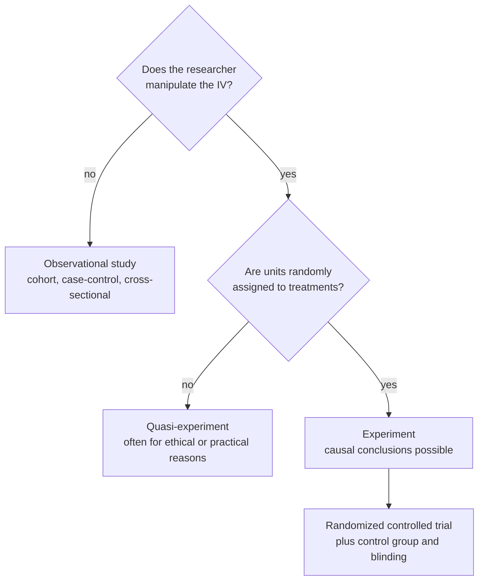

In an experiment, the researcher sets the independent variable and randomly assigns units to treatments. That is what allows a [[Association vs Causation|causal]] conclusion.

Watching the world tells you what goes together. Changing the world tells you what causes what. Suppose you want to know whether X causes Y ([[Independent and Dependent Variables]]). Watching what happens naturally isn't enough, because something else might drive both ([[Nuisance Variables and Confounding]]). The standard definition of an experiment (Kirk 2013) requires three things:
1. **Manipulation:** the researcher sets the independent variable (IV), for example a dose of 2 mg, 4 mg or 8 mg. This means the researcher, not some hidden variable, decides who gets what.
2. **Random assignment:** chance decides which units go into which treatment group. This balances other variables across the groups ([[Random Assignment]]).
3. **Measurement:** the dependent variable (DV), the outcome, is observed or measured, so that any effect shows up in data.

Together, these let you blame a difference in outcomes on the treatment. R. A. Fisher described an experiment as "an experience carefully planned in advance and designed to form a secure basis of new knowledge". It allows a cause to be [[Descriptive vs Inferential Statistics|inferred]] ([[Internal Validity]]). If manipulation or random assignment isn't possible, the study is a [[Quasi-Experiment|quasi-experiment]].

Two yes-or-no questions separate the three kinds of study, and only the bottom path supports a causal claim.

Manipulation guarantees the cause came first. Random assignment means other variables are balanced between the groups on average, so the only systematic difference is the treatment.

For example, the book lists four principles of experimental design ([[References|Vu and Harrington 2020, Ch. 1]], pp. 25–27):
1. **Controlling:** treat the groups the same in every way except the treatment; use a [[Treatment and Control Groups|control group]] and, where possible, a [[Blinding and Placebo|placebo]].
2. **Randomization:** assign units at random so other variables even out.
3. **Replication:** use enough units, and repeat whole studies.
4. **Blocking:** group units by a known nuisance variable, then randomize within each group.

The defining move is control over who gets what, and chance making that choice. A study with a control group isn't automatically an experiment: without random assignment it is a quasi-experiment. And experiments don't necessarily generalize well. Tight control often lowers [[External Validity|external validity]] ([[Why RCTs trade external validity for internal validity]]).

See also: [[Randomized Controlled Trial]].

Further reading: [[References|Kirk 2013, Ch. 1]], [[References|Vu and Harrington 2020, Ch. 1]] (§1.3).
