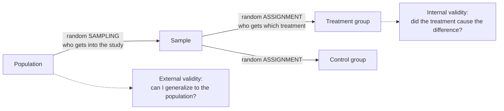

External validity is how far a study's findings can be applied beyond the units actually studied. It depends mainly on randomly sampling from the population you care about.

A result is first of all about the units you studied. Say you study 40 broiler chickens from one farm under ideal lab [[Test Assumptions|conditions]]. Can you say anything about all broilers on commercial farms? Only as far as your 40 represent them ([[Population and Sample]]). External validity is that reach.

The main protection is random sampling from the target population, because a random sample tends to resemble the population, so results carry over ([[Random Sampling]]). Artificial conditions also limit it: results under ideal lab conditions may not hold on a working farm. That is why tightly controlled randomized trials often score high on [[Internal Validity|internal validity]] but lower on external validity ([[Why RCTs trade external validity for internal validity]]).

The two random steps happen at different places and do different jobs. Sampling protects generalization; assignment protects [[Association vs Causation|causation]].

For example, a random sample of Prosecco brands tells you about Prosecco, not about all wine or about Merlot. A random sample of adults in Arkansas tells you about Arkansas adults.

High internal validity doesn't imply high external validity; the two often trade off. And [[Random Assignment|random assignment]] doesn't help you generalize. It improves internal validity, while generalizing needs random sampling.

See also: [[Why random assignment and random sampling protect different things]], [[Validity]].

Further reading: [[References|Kirk 2013, Ch. 1]].
