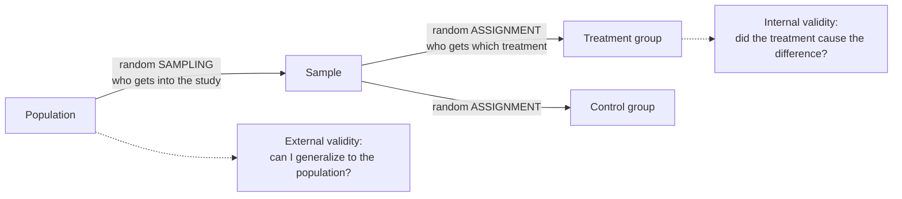

External validity is how far a study's findings can be applied beyond the units actually studied. It depends mainly on randomly sampling from the population you care about.

Imagine testing a new raincoat in a shower stall: perfect water pressure, no wind, five minutes. It stays dry. Does it keep you dry on a mountain in a storm? Maybe, maybe not. The test was real, but its world was small. External validity asks how far you can carry a result out of the world it was found in.

Every result comes with an invisible label: "true for these units, under these conditions". A result is first of all about the units you studied. Say you study 40 broiler chickens from one farm under ideal lab [[Test Assumptions|conditions]]. Can you say anything about all broilers on commercial farms? Only as far as your 40 represent them ([[Population and Sample]]). External validity is that reach.

The main protection is random sampling from the target population, because a random sample tends to resemble the population, so results carry over ([[Random Sampling]]). Artificial conditions also limit it: results under ideal lab conditions may not hold on a working farm. That is why tightly controlled randomized trials often score high on [[Internal Validity|internal validity]] but lower on external validity ([[Why RCTs trade external validity for internal validity]]).

The two random steps happen at different places and do different jobs. Sampling protects generalization; assignment protects [[Association vs Causation|causation]].

Sampling isn't the only thing that limits reach. The study itself can create conditions that don't exist outside it:
- **Volunteers and convenience samples.** People who sign up, or who are easy to reach, may not be like everyone else.
- **Reactive arrangements.** People act differently when they know they're being watched, so the result belongs to the watched version of them.
- **Repeated testing.** A pre-test can change how people respond to the treatment, so the effect may not appear in people who were never pre-tested.
- **Multiple treatments.** If units get several treatments in turn, earlier ones can colour later ones, and the result may only hold in that exact sequence.
- **Selection and treatment together.** A treatment may work only for the kind of units you happened to pick.

Each of these is the same question in a different form: is the world of the study the world you want to talk about?

For example, a random sample of Prosecco brands tells you about Prosecco, not about all wine or about Merlot. A random sample of adults in Arkansas tells you about Arkansas adults.

So when you read a result, always ask: whose world was this measured in, and is that my world? High internal validity doesn't imply high external validity; the two often trade off. And [[Random Assignment|random assignment]] doesn't help you generalize. It improves internal validity, while generalizing needs random sampling.

Try it yourself. A study of sleep and memory used only university students in their twenties. Can you apply its result to people in their seventies? Not safely. The students weren't a random sample of all ages, so the result is about students until someone checks older people.

See also: [[Why random assignment and random sampling protect different things]], [[Validity]].

Further reading: [[References|Kirk 2013, Ch. 1]].
