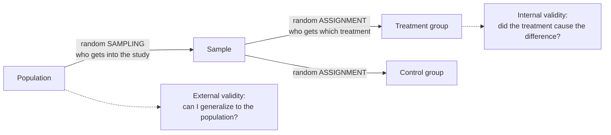

External validity is how far a study's findings can be generalized beyond the units actually studied, and it depends on random sampling from the population of interest.

1. **A result is about the units studied.** I study 40 broilers from one farm under ideal lab [[Test Assumptions|conditions]].
2. **The question is how far it reaches.** Can I say anything about all broilers on commercial farms? Only as far as my 40 represent them ([[Population and Sample]]). External validity is that reach.
3. **Random sampling from the target population is its main protection.** *Why:* a random sample resembles the population, so results transfer ([[Random Sampling]]).
4. **Artificial conditions also limit it.** Results under ideal lab conditions may not hold on a working farm. *Why RCTs often have less of it:* their tight control makes conditions unlike real life ([[Why RCTs trade external validity for internal validity]]).

The two random steps happen at different places and buy different things. Sampling protects generalization; assignment protects [[Association vs Causation|causation]].

A result that holds only for the exact units studied is of limited use. External validity needs **random sampling** from the larger population ([[Random Sampling]]). Tightly controlled RCTs score high on [[Internal Validity|internal validity]] and often **lower on external validity** ([[Why RCTs trade external validity for internal validity]]).

For example:

A worked answer: a random sample of Prosecco brands generalizes to Prosecco, not to all wine or to Merlot. A random sample of adults in Arkansas generalizes to Arkansas adults.

Common mistakes:

- **"High internal validity implies high external validity."** They often trade off.
- **"[[Random Assignment|Random assignment]] improves generalizability."** It improves internal validity; generalizing needs random sampling.

See also: [[Why random assignment and random sampling protect different things]].

Further reading: [[References|Kirk 2013, Ch. 1]].
