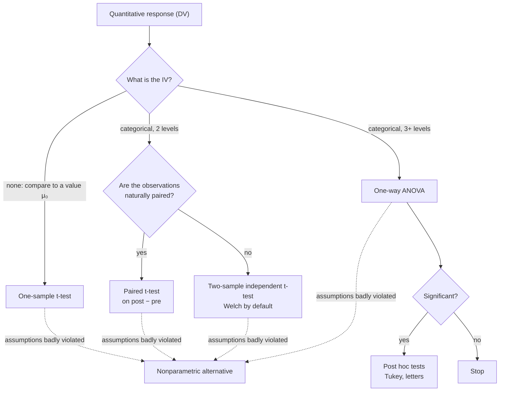

**In one line:** the independent variable (IV) is the one you think drives the outcome, often the one you manipulate; the dependent variable (DV) is the outcome you measure.

> [!info] Before this, it helps to know
> [[Variable and Observation]] (both are variables) · [[Types of Data]] (both can be either type)

## Start from zero
1. **A study asks whether one variable affects another** ([[Variable and Observation]]).
2. **The driver is the independent variable (IV).** In a fertilizer trial, I choose the fertilizer. Other names: explanatory variable, predictor, or, in ANOVA, the **factor** ([[Factors and Levels]]).
3. **The thing measured is the dependent variable (DV)**, because it *depends* on the IV. Here, yield. Also called the response or outcome.
4. **Either can be any type** ([[Types of Data]]). The IV can be qualitative or quantitative, manipulated or intrinsic: sex is qualitative and intrinsic; a dose of 2, 4 or 8 mg is quantitative and manipulated. The DV can also be qualitative or quantitative.
5. **The pair of types picks the analysis.** Categorical IV with a quantitative DV leads to t-tests and ANOVA ([[Test Choice Guide]]). *Why manipulation matters:* only an IV the researcher sets (and assigns at random) supports a [[Association vs Causation|causal]] claim ([[Experiment]]).

## See it

*What to look at:* two questions pick the test: what type the IV is, and (for two groups) whether the data are paired.

## Why it exists
**The IV and DV types decide the classical analysis.** For example:

| IV | DV | Analysis |
|---|---|---|
| categorical, 2 levels | quantitative | two-sample t-test |
| categorical, 3+ levels | quantitative | one-way ANOVA |
| quantitative | quantitative | correlation, regression |
| categorical | categorical | chi-square |

See [[Test Choice Guide]]. The online flow charts are "helpful for a starter path".

## A tiny example
COVID data: "child under 12 at home" (no/yes) is the IV with 2 levels; March distress score is the DV → two-sample t-test. Undergraduate major (4 levels) and frustration score → one-way ANOVA.

## Common confusions
- **"Independent variable means it is statistically independent."** Different meaning entirely: here it just means "explanatory".
- **"The IV must be manipulated."** Not in observational studies; then causal claims get weaker ([[Quasi-Experiment]]).

## Connections
- **Builds on:** [[Variable and Observation]], [[Types of Data]]
- **Leads to:** [[Factors and Levels]], [[Test Choice Guide]], [[Experiment]], [[Nuisance Variables and Confounding]]
- **Part of:** [[MOC - Study Design and Sampling]]
- **Go deeper:** [[References|Kirk 2013, Ch. 1]]
- **Terms used:** [[Correlation]], [[Chi-Square Test]], [[Regression]]
