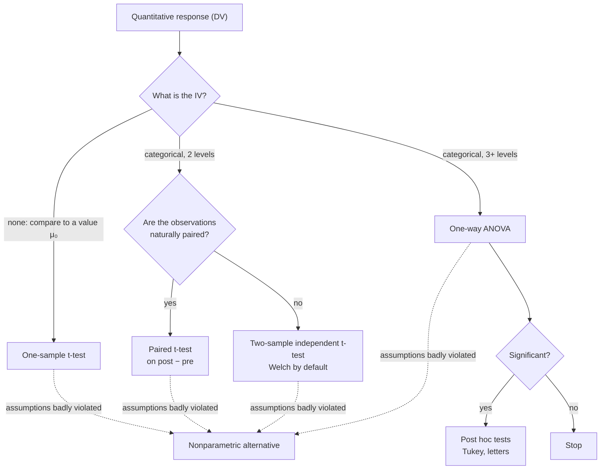

The independent variable (IV) is the one you think drives the outcome, and often the one you control. The dependent variable (DV) is the outcome you measure.

Every study is a question of the form "does this affect that?", and these two names are just the "this" and the "that". A study asks whether one variable affects another ([[Variable and Observation]]). In a fertilizer trial, you choose the fertilizer: that is the independent variable. It is also called the explanatory variable or predictor, and in ANOVA the **factor** ([[Factors and Levels]]). The crop yield is the dependent variable, because it depends on the fertilizer. It is also called the response or outcome.

Either one can be any type of data ([[Types of Data]]). The independent variable can be categorical or quantitative, and set by the researcher or simply part of the subject. Sex is categorical and part of the subject; a dose of 2, 4 or 8 mg is quantitative and set by the researcher. Only an independent variable that the researcher sets, and assigns at random, supports a [[Association vs Causation|causal]] claim ([[Experiment]]).

The types of the two variables pick the analysis:

| Independent variable | Dependent variable | Analysis |
|---|---|---|
| categorical, 2 levels | quantitative | two-sample t-test |
| categorical, 3+ levels | quantitative | one-way ANOVA |
| quantitative | quantitative | [[Correlation\|correlation]], regression |
| categorical | categorical | chi-square |

Two questions pick the test: what type the independent variable is, and, for two groups, whether the data are paired. The [[Test Choice Guide]] covers this in more detail.

For example, in a COVID survey, "child under 12 at home" (no or yes) is an independent variable with 2 levels, and the March distress score is the dependent variable, so the analysis is a two-sample t-test. Undergraduate major (4 levels) and a frustration score call for a one-way ANOVA.

Name these two first and most of the design decisions follow. "Independent" here has nothing to do with statistical independence; it just means "explanatory". And the independent variable doesn't have to be set by the researcher. In observational studies it isn't, and then causal claims are weaker ([[Quasi-Experiment]]).

See also: [[Nuisance Variables and Confounding]].

Further reading: [[References|Kirk 2013, Ch. 1]].
