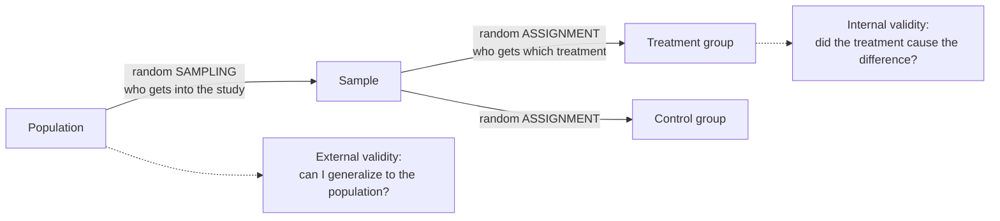

**In one line:** internal validity is how confidently you can say that the independent variable, and not something else, caused the change in the dependent variable.

> [!info] Before this, it helps to know
> [[Independent and Dependent Variables]] (the [[Association vs Causation|causal]] claim) · [[Nuisance Variables and Confounding]] (the main threat) · [[Random Assignment]] (its main protection)

## Start from zero
1. **The claim is "the IV caused the change in the DV"** ([[Independent and Dependent Variables]]).
2. **Internal validity is how far that claim can be trusted.**
3. **Any "third variable" that could explain the result instead of the treatment is a threat to internal validity** ([[Nuisance Variables and Confounding]]).
4. **The defense is random assignment of individual units to treatment groups.** *Why:* it balances third variables between groups ([[Random Assignment]]). Some threats need more than that:

| Threat | What happens | Class example |
|---|---|---|
| **Confounding** | a nuisance variable tied to both treatment and response | older chickens all on one diet |
| **Maturation** | subjects change naturally over time | children's reading at age 6 and again at 9 |
| **Testing effects** | repeated testing improves scores by itself | taking the same exam three times |
| **Attrition** | units drop out or die | loss to follow-up in long RCTs |
| **Diffusion of treatment** | treatment leaks between groups | participants share information |
| **Compensatory rivalry** | the control group works harder to prove itself | "I'll show you I'm good even on placebo" |
| **Resentful demoralization** | the control group gives up | "Fine, whatever" |

5. **Subject behaviour and placebo effects threaten it too** ([[Blinding and Placebo]]).

## See it

*What to look at:* the two random steps happen at different places and buy different things. Sampling protects generalization; assignment protects causation.

## Why it exists
A study can be perfectly analyzed and still answer the wrong question if a third variable produced the effect. Internal validity is what makes a causal claim believable.

## A tiny example
Pens of animals placed side by side might share air, [[Signal and Noise|noise]] or disease: a diffusion-of-treatment problem that a reviewer could raise. Limitations sections are often internal-validity issues like this.

## Common confusions
- **"Internal validity is about generalizing."** That is [[External Validity]].
- **"A big [[Population and Sample|sample]] protects internal validity."** Size doesn't fix confounding; randomization does.

## Connections
- **Builds on:** [[Nuisance Variables and Confounding]], [[Random Assignment]], [[Independent and Dependent Variables]]
- **Leads to:** [[External Validity]], [[Why random assignment and random sampling protect different things]], [[Why RCTs trade external validity for internal validity]]
- **Part of:** [[MOC - Study Design and Sampling]]
- **Go deeper:** [[References|Kirk 2013, Ch. 1]]
