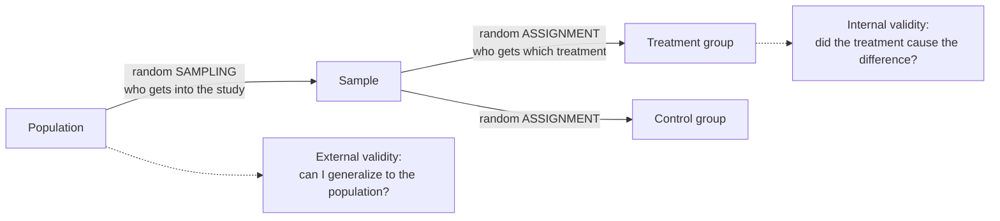

Internal validity is how confidently you can say that the treatment, and not something else, caused the change in the outcome.

Picture a teacher who tries a new teaching method in September and finds the class's scores higher by December. Was it the method? Or did the children just get older and learn anyway? Did a big exam scare them into studying? Did the December test happen to be easier? Each of those is another way the result could have happened. Internal validity is about closing those doors one by one.

Think of internal validity as the question a sceptical friend would ask: "Are you sure it was the treatment?" A study's claim is usually "the independent variable caused the change in the dependent variable" ([[Independent and Dependent Variables]]). Internal validity is how far that claim can be trusted. Anything else that could explain the result, a "third variable", is a threat to it ([[Nuisance Variables and Confounding]]). The main defence is randomly assigning individual units to the treatment groups, which balances third variables between the groups ([[Random Assignment]]). Some threats need more than that:

| Threat | What happens | Example |
|---|---|---|
| **Confounding** | another variable is tied to both the treatment and the outcome | older chickens all on one diet |
| **History** | something outside the study happens during it and moves everyone's outcome | a heatwave halfway through a feeding trial |
| **Maturation** | subjects change naturally over time | children's reading at age 6 and again at 9 |
| **Testing effects** | repeated testing improves scores by itself | taking the same exam three times |
| **Attrition** | units drop out or die | people lost to follow-up in long trials |
| **Instrument changes** | the measuring tool or the person scoring drifts over time | a scale recalibrated between the before and after weighings |
| **Diffusion of treatment** | the treatment leaks between groups | participants share information |
| **Compensatory rivalry** | the control group works harder to prove itself | trying to show they can do well without the treatment |
| **Resentful demoralization** | the control group gives up | losing interest after missing out on the treatment |

People's behaviour and placebo effects threaten it too ([[Blinding and Placebo]]).

The two random steps happen at different places and do different jobs. Sampling protects generalization; assignment protects [[Association vs Causation|causation]].

A study can be perfectly analysed and still mislead if a third variable produced the effect. Internal validity is what makes a causal claim believable.

For example, pens of animals placed side by side might share air, noise or disease, so the treatment could spread between them. A reviewer could raise this, and the "limitations" section of a paper is often about issues like it.

The deep point is that size can't buy you this. Only design can. Internal validity isn't about generalizing to other settings; that is [[External Validity|external validity]]. And a big [[Population and Sample|sample]] doesn't protect it: size doesn't fix confounding, but randomization does.

Try it yourself. Patients who chose a new therapy recovered faster than those who didn't. Name one threat to internal validity. Selection: the people who chose the therapy may have been healthier or more motivated to begin with. Random assignment would have removed that.

See also: [[Why random assignment and random sampling protect different things]], [[Why RCTs trade external validity for internal validity]], [[Validity]].

Further reading: [[References|Kirk 2013, Ch. 1]].
