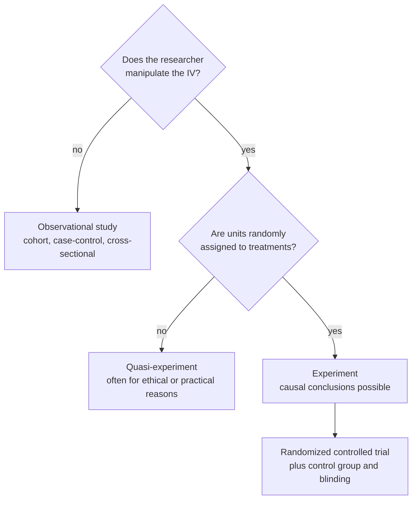

In an observational study the researcher watches rather than assigns. The three main designs are cohort studies, which follow people forward; case-control studies, which look back from an outcome; and cross-sectional studies, which take a snapshot.

Sometimes you can't assign the exposure, such as smoking, a disease or where an animal lives in a barn, so you observe it instead. Without [[Random Assignment|random assignment]], other variables can line up with the exposure ([[Nuisance Variables and Confounding]]). Each design handles time and cost differently:

| Design | How it works | Strength | Weakness |
|---|---|---|---|
| **Cohort (prospective)** | Pick a group, note who has which exposure (not assigned), and follow them forward | The exposure comes before the outcome; results generalize better | Slow and expensive for rare or slow-developing outcomes; weaker internal validity than a trial |
| **Case-control (retrospective)** | Find **cases** with the outcome (birds with a rare disease) and matched **controls** without it, then look back at their exposures | Efficient for **rare outcomes**; many risk factors at once | Cases must be defined carefully (long-sick or newly diagnosed); problems with memory and with who gets selected |
| **Cross-sectional** | One point in time ("this animal is sick, eats this diet, lives in this part of the barn") | **Cheapest** and fastest | **Can't tell which came first** |

Time order matters because a cause must come before its effect. Cohort studies can see the order; cross-sectional studies can't.

Two yes-or-no questions about the independent variable (IV) separate the three kinds of study, and only the bottom path supports a [[Association vs Causation|causal]] claim.

Many exposures can't be assigned, like smoking, lead, or diet over decades, and observational designs let us study them anyway. They show association, not causation, because of confounding: a variable tied to both the exposure and the outcome. For example, sun exposure links sunscreen use with skin cancer ([[References|Vu and Harrington 2020, Ch. 1]], pp. 27–29).

For example, long cohort studies can reveal unexpected links: smoking was tied to heart disease and to dental health. Findings like these suggest [[Null and Alternative Hypotheses|hypotheses]] to test later in a [[Randomized Controlled Trial|randomized trial]].

A strong association doesn't prove causation: without random assignment, a confounder may explain it. And case-control studies don't follow people forward; they start from the outcome and look back.

See also: [[Internal Validity]], [[External Validity]], [[Quasi-Experiment]].

Further reading: [[References|Vu and Harrington 2020, Ch. 1]] (pp. 27–29).
