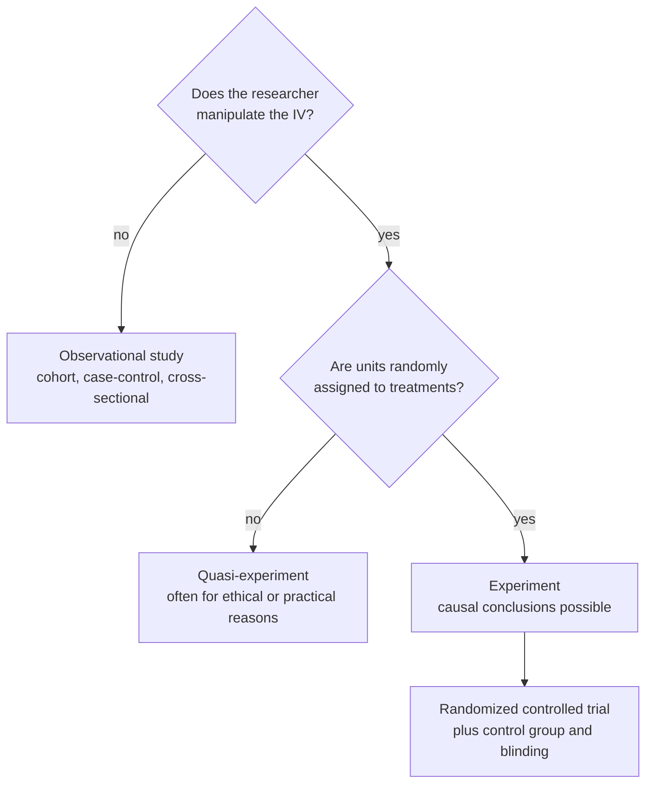

In an observational study the researcher watches rather than assigns; the three main designs are cohort (follow forward), case-control (look backward from an outcome) and cross-sectional (a snapshot).

1. **Sometimes you can't assign the exposure** (smoking, a disease, a barn's location), so you observe it instead ([[Randomized Controlled Trial]]).
2. **Without [[Random Assignment|random assignment]], nuisance variables can line up with the exposure** ([[Nuisance Variables and Confounding]]). Each design handles time and cost differently:

| Design | How it works | Strength | Weakness |
|---|---|---|---|
| **Cohort (prospective)** | Identify a group, note who gets which exposure (not assigned), follow them forward | Exposure precedes outcome; better generalizability | Slow and expensive for rare or long-latency outcomes; internal validity "starts to sag" |
| **Case-control (retrospective)** | Find **cases** with the outcome (birds with a rare disease) and matched **controls** without it, then look back at exposures | Efficient for **rare outcomes**; many risk factors at once | Cases must be defined carefully (long-sick vs newly diagnosed); recall and selection problems |
| **Cross-sectional** | One time point ("this animal is sick, eats this diet, lives in this part of the barn") | **Cheapest**, fastest | **Can't tell which came first** (chicken and egg) |

3. **Why time order matters:** a cause must come before its effect. Cohorts see the order; cross-sectional studies can't.

Two yes/no questions separate the three kinds of study, and only the bottom path supports a [[Association vs Causation|causal]] claim.

Many exposures cannot be assigned (smoking, lead, diet over decades). Observational designs study them anyway. They show **association, not causation**, because of confounding: a variable tied to both the exposure and the outcome, such as sun exposure linking sunscreen use and skin cancer ([[References|Vu and Harrington 2020, Ch. 1]], pp. 27–29).

For example:

Long cohort studies can reveal unexpected links: smoking was tied to heart disease and to dental health. Such findings generate [[Null and Alternative Hypotheses|hypotheses]] for later RCTs.

Common mistakes:

- **"A strong association proves causation."** Without random assignment, a confounder may explain it.
- **"Case-control studies follow people forward."** They start from the outcome and look backward.

See also: [[Internal Validity]], [[External Validity]], [[Quasi-Experiment]].

Further reading: [[References|Vu and Harrington 2020, Ch. 1]] (pp. 27–29).
