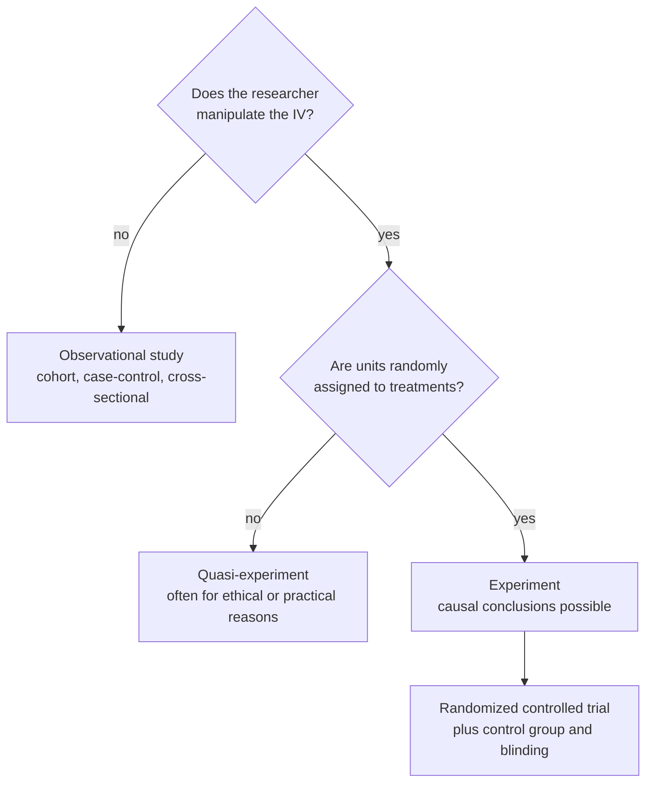

A quasi-experiment compares groups like an experiment does, but the researcher can't set the [[Independent and Dependent Variables|independent variable]] (IV) or can't randomly assign units to groups, usually for practical or ethical reasons.

A true experiment needs both manipulation and random assignment ([[Experiment]]). Some variables simply can't be assigned:
- the age of cattle, or how many calves a cow has already had;
- birth order (first-born or later-born) and achievement;
- student performance at two different schools;
- lead in drinking water, since you can't ethically make people live in a high-lead town.

You can still compare the groups, but units ended up in their groups through some process you didn't control. That process may also affect the outcome, so confounding can't be ruled out and [[Association vs Causation|causal]] claims are weaker ([[Nuisance Variables and Confounding]], [[Random Assignment]]). Quasi-experiments are sometimes called non-randomized controlled trials.

Two yes-or-no questions separate the three kinds of study, and only the bottom path supports a causal claim.

Many important questions can't be studied with true experiments. Quasi-experiments let us study them anyway, at the cost of weaker causal claims.

For example, in a study of blood lead level (low, medium or high) and IQ analysed with ANOVA, the lead groups weren't assigned. Even a significant result only shows an association, which could be due to something like household income.

Quasi-experiments aren't bad science; they are often the only ethical option, as long as you state the limitation. They are close cousins of observational studies, but usually involve a planned comparison of defined groups, often with some researcher control.

See also: [[Observational Study Designs]], [[Internal Validity]].

Further reading: [[References|Kirk 2013, Ch. 1]].
