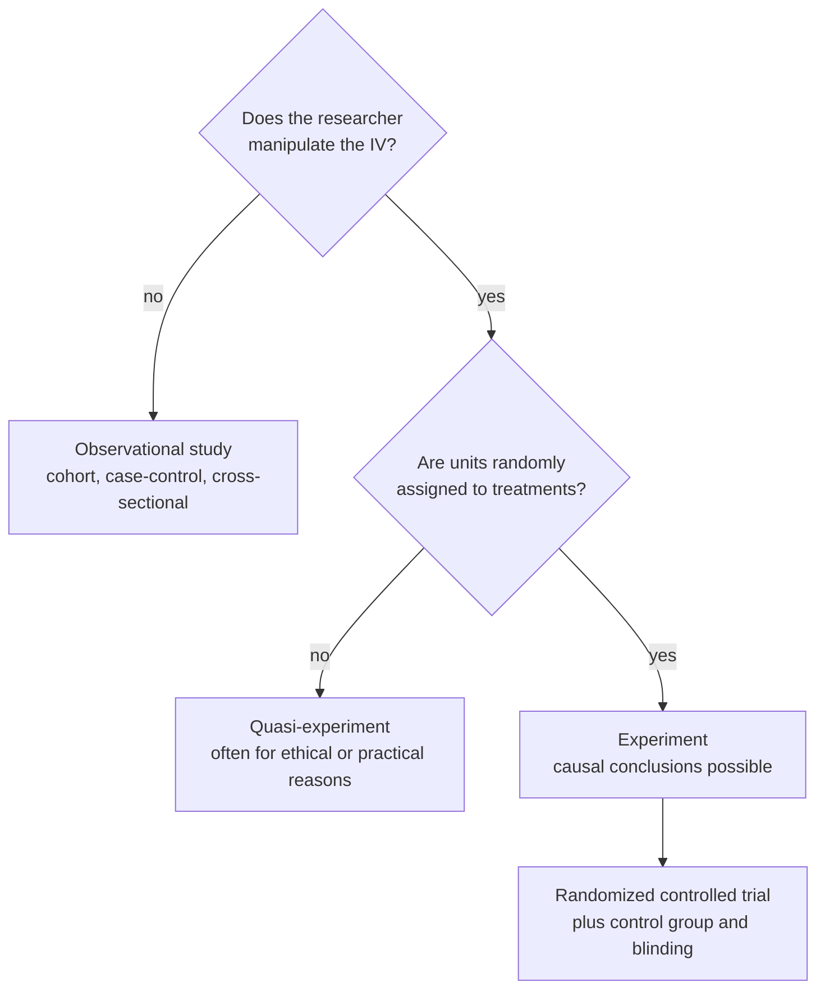

**In one line:** a quasi-experiment compares groups like an experiment, but the researcher cannot manipulate the [[Independent and Dependent Variables|IV]] or cannot randomly assign units, usually for practical or ethical reasons.

> [!info] Before this, it helps to know
> [[Experiment]] (what is missing) · [[Random Assignment]] (the missing ingredient)

## Start from zero
1. **A true experiment needs manipulation and random assignment** ([[Experiment]]).
2. **Some IVs simply cannot be assigned:**
   - The **age of cattle**, or the number of calves already born ("Cattle, hurry up, I need you to have 5").
   - **Birth order** and achievement (first-born vs later-born).
   - Student performance at **two different schools**.
   - **Lead in drinking water:** you cannot ethically assign people to live in a high-lead town.
3. **You can still compare groups,** but units arrived in their groups by some process you didn't control. *Consequence:* that process may also affect the outcome, so confounding can't be ruled out and [[Association vs Causation|causal]] claims are weaker ([[Nuisance Variables and Confounding]], [[Random Assignment]]).
4. **Quasi-experiments are sometimes called non-randomized controlled trials.**

## See it

*What to look at:* two yes/no questions separate the three kinds of study, and only the bottom path supports a causal claim.

## Why it exists
Many important questions cannot be studied experimentally. Quasi-experiments let us study them anyway, at the cost of weaker causal claims: without random assignment, a nuisance variable tied to group membership may explain the difference ([[Nuisance Variables and Confounding]]).

## A tiny example
Blood lead level (low, medium, high) and IQ, an ANOVA example: the lead groups were not assigned, so even a significant result shows an association that could be confounded with, say, household income.

## Common confusions
- **"Quasi-experiments are bad science."** They are often the only ethical option. State the limitation.
- **"A quasi-experiment is the same as an observational study."** Close cousins; in a quasi-experiment there is usually a planned comparison of defined groups, often with some researcher control.

## Connections
- **Builds on:** [[Experiment]], [[Random Assignment]]
- **Leads to:** [[Observational Study Designs]], [[Internal Validity]]
- **Part of:** [[MOC - Study Design and Sampling]]
- **Go deeper:** [[References|Kirk 2013, Ch. 1]]
