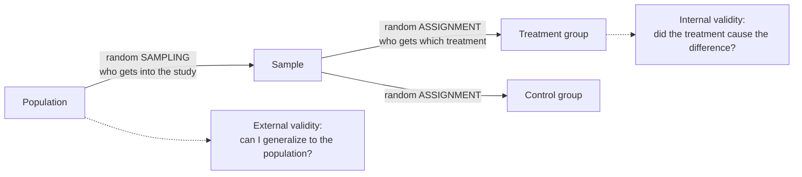

Random assignment uses chance to decide which [[Treatment and Control Groups|treatment group]] each experimental unit goes to, so that nuisance variables are balanced across groups and the treatment is the only systematic difference.

1. **Confounding happens when a nuisance variable lines up with the treatment** ([[Nuisance Variables and Confounding]]).
2. **People choosing groups create that line-up.** I have 40 chickens and two diets. If I pick which chickens get diet A, I might (without meaning to) pick the bigger, livelier ones.
3. **So let chance choose.** If a random number generator picks, big and small, old and young, end up mixed into both groups. *Why chance works:* it can't prefer any kind of chicken, so it can't line up with anything.
4. **Any nuisance variable, measured or not, is spread out evenly on average.** *Consequence:* the only systematic difference left between groups is the treatment, so a difference in outcome can be credited to it. That's what lets an [[Experiment]] support [[Association vs Causation|causation]] ([[Internal Validity]]).
5. **It is not the same as random sampling.** Random assignment protects the comparison; random sampling protects generalizing to a [[Population and Sample|population]] ([[Why random assignment and random sampling protect different things]]).

The two random steps happen at different places and buy different things. Sampling protects generalization; assignment protects causation.

It protects **internal validity**: the right to say the [[Independent and Dependent Variables|IV]] *caused* the change in the DV ([[Internal Validity]]). Without it, confounding can't be ruled out, causation can't be inferred, and the study becomes a [[Quasi-Experiment]].

For example:

Assigning plots of land or chickens to diets at random, "so that the older chickens aren't all in one group".

| | Random assignment | Random sampling |
|---|---|---|
| What is random | which group each unit joins | which units enter the study |
| Protects | internal validity (causation) | [[External Validity\|external validity]] (generalization) |

Common mistakes:

- **"Random assignment makes my sample representative."** It does nothing for representativeness; that needs [[Random Sampling]].
- **"Alternating assignment (1st A, 2nd B, ...) is random."** It is systematic and can line up with hidden patterns.

See also: [[Classical vs Relative Frequency Probability]], [[Randomized Controlled Trial]].

Further reading: [[References|Kirk 2013, Ch. 1]], [[References|Vu and Harrington 2020, Ch. 1]] (pp. 25–27).
