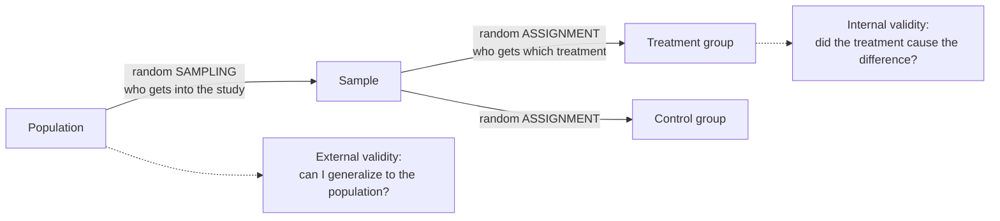

Random assignment uses chance to decide which [[Treatment and Control Groups|treatment group]] each unit goes into. This balances other variables across the groups, so the treatment is the only systematic difference between them.

This is one of the simplest and most powerful ideas in all of science: let a coin decide. Confounding happens when another variable lines up with the treatment ([[Nuisance Variables and Confounding]]). People choosing the groups can create that line-up. With 40 chickens and two diets, if you pick which chickens get diet A, you might, without meaning to, pick the bigger and livelier ones. So let chance choose. If a random number generator decides, big and small, old and young chickens end up mixed into both groups. Chance can't prefer any kind of chicken, so it can't line up with anything.

As a result, every other variable, measured or not, is spread evenly across the groups on average. The only systematic difference left is the treatment, so a difference in outcome can be credited to it. That is what lets an [[Experiment|experiment]] support a claim of [[Association vs Causation|causation]], and it is called [[Internal Validity|internal validity]]. Without random assignment, confounding can't be ruled out, and the study becomes a [[Quasi-Experiment|quasi-experiment]].

Random assignment is not the same as random sampling. Assignment protects the comparison between groups; sampling protects your ability to generalize to a [[Population and Sample|population]] ([[Why random assignment and random sampling protect different things]]).

The two random steps happen at different places and do different jobs. Sampling protects generalization; assignment protects causation.

For example, plots of land or chickens are assigned to diets at random, so that the older chickens don't all end up in one group.

| | Random assignment | Random sampling |
|---|---|---|
| What is random | which group each unit joins | which units enter the study |
| Protects | internal validity (causation) | [[External Validity\|external validity]] (generalization) |

The coin's virtue is that it has no opinions. Random assignment does nothing to make a sample representative; that needs [[Random Sampling|random sampling]]. And alternating (first unit to A, second to B, and so on) isn't random. It is systematic and can line up with hidden patterns.

Try it yourself. You have 10 plots, and you put the new fertilizer on the 5 plots nearest the river because they're easiest to reach. Why is that a problem, and what would random assignment do? Plots near the river might be wetter or richer, so the fertilizer gets credit for the river. Flipping a coin for each plot spreads river and non-river plots across both groups.

See also: [[Randomized Controlled Trial]], [[Classical vs Relative Frequency Probability]], [[Independent and Dependent Variables]].

Further reading: [[References|Kirk 2013, Ch. 1]], [[References|Vu and Harrington 2020, Ch. 1]] (pp. 25–27).
