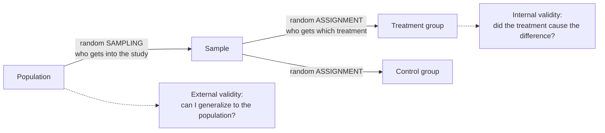

Random sampling uses chance to decide which members of a population get into a study. This makes the sample representative, so the results can be generalized.

Imagine judging a whole cake by one bite. If you always bite the edge, you'll think it's all crust. If you choose your bite with your eyes closed, from anywhere, then over many bites you'll get a fair taste of the whole cake. Random sampling is the eyes-closed bite: it stops your convenience, or your hopes, from choosing for you.

If you want a small piece to tell you about the whole, you can't let convenience pick the piece. A sample is only useful if it resembles the population ([[Population and Sample]]). Choosing by convenience tilts it: the 500 plants nearest the road are easy to reach but unusual, with more dust, different drainage and edge effects. So hand the choice to chance. Give every plant a chance of being chosen and let a random draw pick 500. A random draw can't favour any kind of plant, so the samples it produces have no systematic tilt ([[Sampling Bias]]). A **simple random sample** goes further: every possible group of $n$ units is equally likely to be picked, like drawing names from a hat ([[Sampling Methods]]).

Randomness also makes the error predictable. Because the draw follows known probabilities, you can work out how much [[Parameter vs Statistic|sample statistics]] will vary ([[Sampling Distribution]]). That is what lets results generalize to the population, which is called [[External Validity|external validity]] ([[Why random assignment and random sampling protect different things]]).

The two random steps happen at different places and do different jobs. Sampling protects generalization; assignment protects [[Association vs Causation|causation]].

![[Sampling methods.png|700]]
Four ways chance can pick a sample from the same population of 80 units (gray). Red dots are the units that end up in the sample.

[[Descriptive vs Inferential Statistics|Statistical inference]] assumes a random sample of independent observations. The book is blunt about it: if the data are not from a random sample, "the confidence interval no longer has interpretive value, since there is no population mean to which the confidence interval applies" ([[References|Vu and Harrington 2020, Ch. 4]], p. 210; [[Confidence Interval]], [[Hypothesis Testing]]).

For example, the book describes four combinations:

| | [[Random Assignment\|Random assignment]] | No random assignment |
|---|---|---|
| **Random sampling** | causal conclusions that generalize (ideal, rare) | associations that generalize (a survey) |
| **No random sampling** | causal conclusions for units like these (a typical [[Randomized Controlled Trial\|randomized controlled trial]] with volunteers) | association in this sample only |

Randomness here is a tool for fairness, not a sign of carelessness. Random sampling doesn't let you claim causation; only random assignment does that. And picking "whatever seems random" isn't random: people choose in subtly biased ways, so use an actual random process.

Try it yourself. To learn how students feel about the library, you survey the people sitting in the library. What's wrong with that sample? It only reaches people who already use the library, who probably like it more. A random sample from the list of all students would fix it.

See also: [[Classical vs Relative Frequency Probability]].

Further reading: [[References|Vu and Harrington 2020, Ch. 1]] (pp. 19–24), [[References|Vu and Harrington 2020, Ch. 4]] (p. 210).
