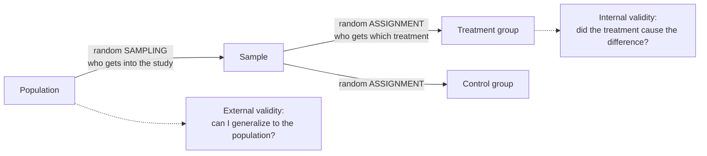

**In one line:** random sampling uses chance to decide which members of the population get into the study, so the sample is representative and results can be generalized.

> [!info] Before this, it helps to know
> [[Population and Sample]] (what is being chosen) · [[Classical vs Relative Frequency Probability]] (random means known chances)

## Start from zero
1. **A sample is only useful if it resembles the population** ([[Population and Sample]]).
2. **Choosing by convenience tilts it.** The 500 plants nearest the road are convenient but odd (dust, drainage, edge effects).
3. **So hand the choice to chance.** Give every plant a chance to be chosen and let a random draw pick 500. *Why chance works:* a random draw can't favour any kind of plant, so over many such draws the samples look like the population, with no systematic tilt ([[Sampling Bias]]).
4. **A simple random sample (SRS) goes further:** every possible group of $n$ units is equally likely, like names drawn from a hat ([[Sampling Methods]]).
5. **Randomness also makes the error predictable.** Because the draw follows known probabilities, the spread of [[Parameter vs Statistic|sample statistics]] can be worked out ([[Sampling Distribution]]). *Why that matters:* this is what lets results generalize to the population ([[External Validity]], [[Why random assignment and random sampling protect different things]]).

## See it

*What to look at:* the two random steps happen at different places and buy different things. Sampling protects generalization; assignment protects [[Association vs Causation|causation]].

![[Sampling methods.png|700]]
*What to look at:* Four ways chance can pick a sample from the same population of 80 units (gray). Red dots are the units that end up in the sample.

## Why it exists
1. It protects **external validity**: generalizing to the population ([[External Validity]]).
2. **[[Descriptive vs Inferential Statistics|Statistical inference]] assumes it.** Confidence intervals and [[Hypothesis Testing|hypothesis tests]] assume a random sample of independent observations. The book is blunt: if the data are not from a random sample, "the confidence interval no longer has interpretive value, since there is no population mean to which the confidence interval applies" ([[References|Vu and Harrington 2020, Ch. 4]], p. 210).

## A tiny example
The four combinations (book framing):
| | [[Random Assignment\|Random assignment]] | No random assignment |
|---|---|---|
| **Random sampling** | causal conclusions that generalize (ideal, rare) | generalizable associations (a survey) |
| **No random sampling** | causal conclusions for units like these (a typical [[Randomized Controlled Trial\|RCT]] with volunteers) | association in this sample only |

## Common confusions
- **"Random sampling lets me claim causation."** Only random assignment does that.
- **"Haphazard is random."** Picking "whatever seems random" is biased in subtle ways; use an actual random process.

## Connections
- **Builds on:** [[Population and Sample]], [[Sampling Methods]], [[Classical vs Relative Frequency Probability]]
- **Leads to:** [[External Validity]], [[Confidence Interval]], [[Sampling Distribution]]
- **Part of:** [[MOC - Study Design and Sampling]]
- **Go deeper:** [[References|Vu and Harrington 2020, Ch. 1]] (pp. 19–24), [[References|Vu and Harrington 2020, Ch. 4]] (p. 210)
