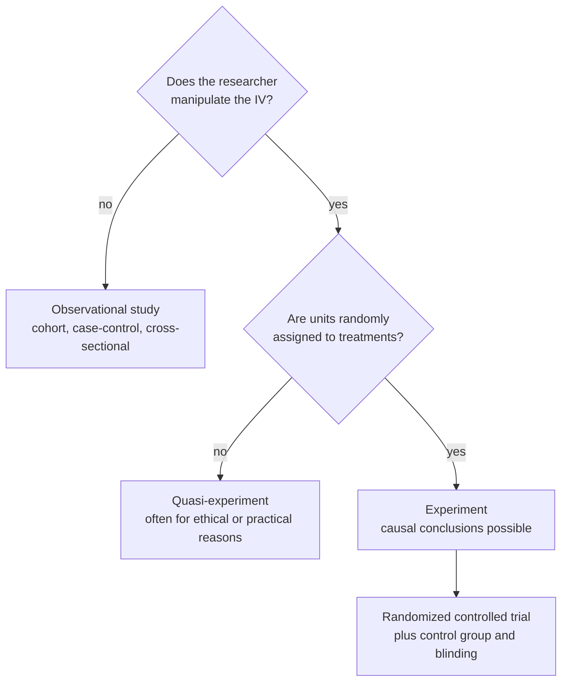

A randomized controlled trial (RCT) randomly assigns units to a treatment or a control group, ideally with nobody knowing who is in which. It is the gold standard for showing that a treatment causes an effect.

The steps:
1. Recruit participants.
2. Use a computerized coin flip to put each one in the treatment or control group. Random assignment balances everything else between the groups ([[Random Assignment]]).
3. Give the [[Treatment and Control Groups|control group]] a placebo, so both groups believe they might be treated and belief can't explain a difference ([[Blinding and Placebo]]).
4. Keep both the participants and the researchers unaware of who got what. This is called double-blind, and it stops behaviour or measurement leaning towards the treatment.
5. Compare the outcomes. Any difference beyond chance is credited to the treatment ([[Experiment]], [[Internal Validity]]).

Two yes-or-no questions about the independent variable (IV) separate the three kinds of study, and only the bottom path supports a [[Association vs Causation|causal]] claim.

| Strengths | Weaknesses |
|---|---|
| Maximum control, with little room for [[Nuisance Variables and Confounding\|confounding]] | Unrealistic for **rare outcomes** |
| The exposure clearly comes before the outcome | Blinding isn't always possible (knee surgery against therapy: everyone knows their group) |
| **The highest internal validity** | People drop out before the end |
| | **Lower external validity**: volunteers can differ from typical patients, and a strict trial routine isn't real life |

As control goes up, internal validity goes up and external validity tends to go down ([[Why RCTs trade external validity for internal validity]], [[External Validity]]).

For example, in an arrhythmia trial described in the book, researchers expected a new drug to reduce deaths. The trial was stopped when the drug turned out to be almost 4 times as likely to kill patients as a placebo ([[References|Vu and Harrington 2020, Ch. 4]], p. 223). A randomized trial can reveal harm because it compares like with like.

Trial results apply most clearly to people like the volunteers who were studied, not automatically to everyone. And "randomized" refers to random assignment, not random sampling ([[Why random assignment and random sampling protect different things]]).

See also: [[Observational Study Designs]].

Further reading: [[References|Vu and Harrington 2020, Ch. 1]] (§1.3).
