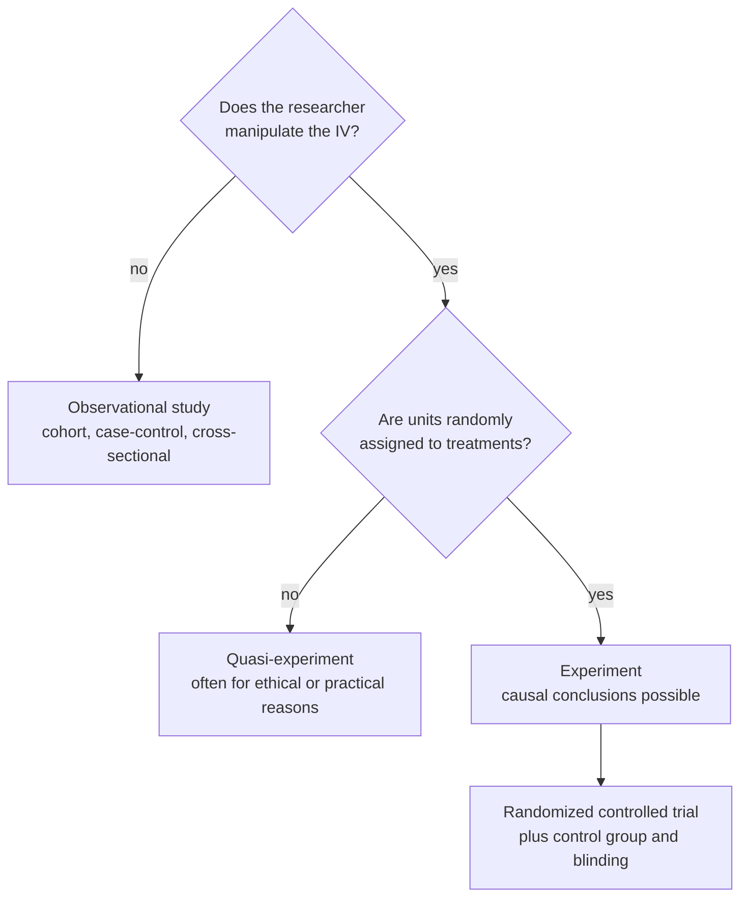

An RCT randomly assigns units to treatment or control, ideally double-blind, and is the gold standard for showing that a treatment causes an effect.

1. **Recruit participants.**
2. **Flip a (computerized) coin for each to decide treatment or control.** *Why:* random assignment balances everything else between groups ([[Random Assignment]]).
3. **Give the [[Treatment and Control Groups|control group]] a placebo.** *Why:* both groups then believe they might be treated, so belief can't explain a difference ([[Blinding and Placebo]]).
4. **Keep both the participants and the researchers unaware of who got what (double-blind).** *Why:* neither behaviour nor measurement can lean towards the treatment.
5. **Then compare outcomes.** Any remaining difference beyond chance is credited to the treatment ([[Experiment]], [[Internal Validity]]). The cost is that the strict setting may not resemble real life ([[Why RCTs trade external validity for internal validity]]).

Two yes/no questions separate the three kinds of study, and only the bottom path supports a [[Association vs Causation|causal]] claim.

| Pros | Cons |
|---|---|
| Maximum control, minimal [[Nuisance Variables and Confounding\|confounding]] | Unreasonable for **rare outcomes** |
| The exposure clearly comes before the outcome | Blinding is not always possible (knee surgery vs therapy: everyone knows their group) |
| **Highest internal validity** | Loss to follow-up |
| | **Low external validity**: volunteers are "odd, desperate, etc.", and enforced adherence doesn't match real life |

The trade-off: as control goes up, internal validity goes up and external validity tends to go down ([[Why RCTs trade external validity for internal validity]]).

For example:

Book arrhythmia trial: researchers expected a new drug to reduce deaths; the trial was stopped when the drug turned out to be almost 4 times as likely to kill patients as a placebo ([[References|Vu and Harrington 2020, Ch. 4]], p. 223). An RCT can reveal harm because it compares like with like.

Common mistakes:

- **"RCT results apply to everyone."** They apply most clearly to people like the volunteers studied.
- **"Randomized means randomly sampled."** Random *assignment* is not random *sampling* ([[Why random assignment and random sampling protect different things]]).

See also: [[External Validity]], [[Observational Study Designs]].

Further reading: [[References|Vu and Harrington 2020, Ch. 1]] (§1.3).
